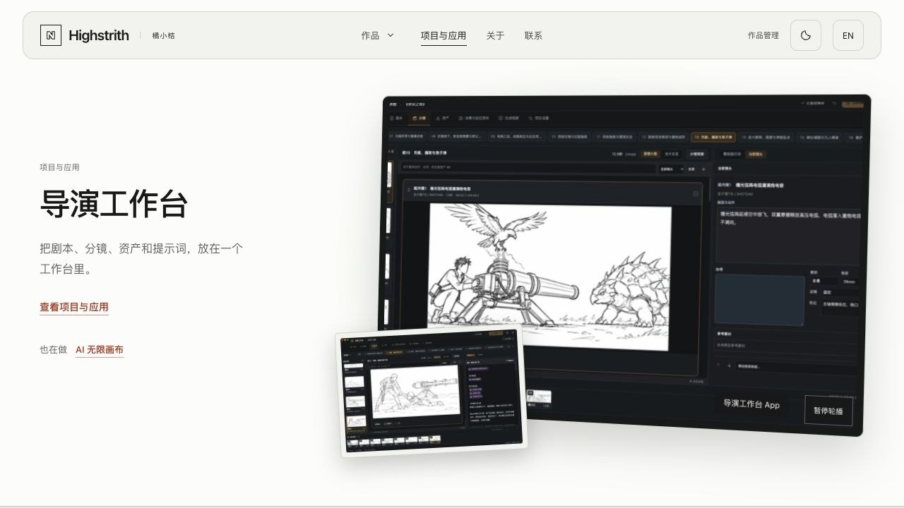
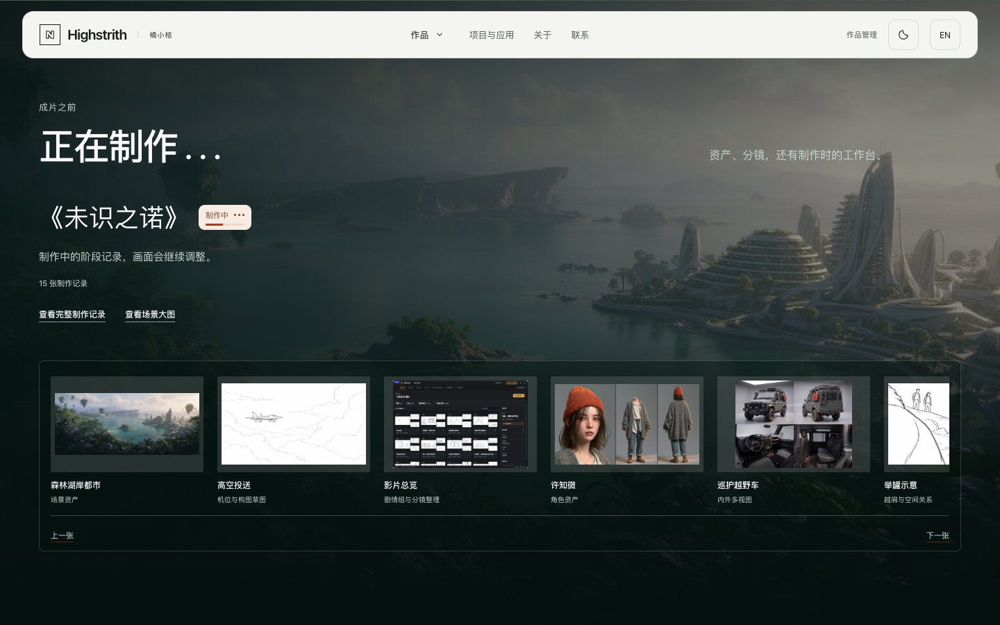
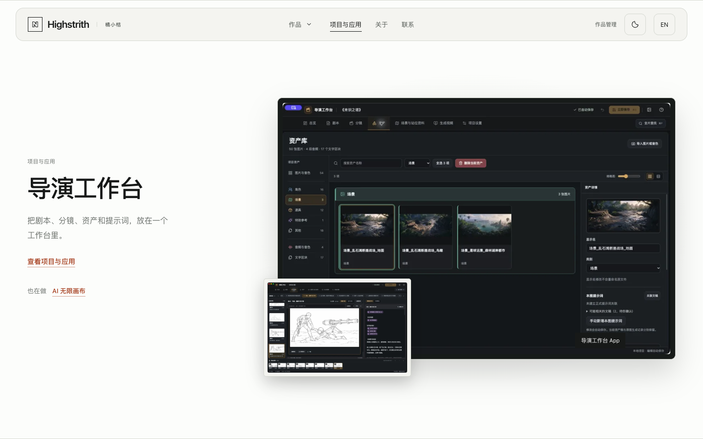
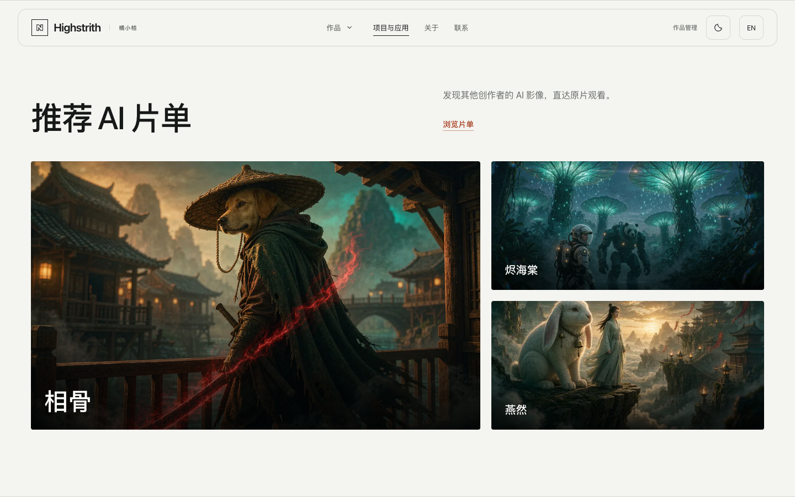
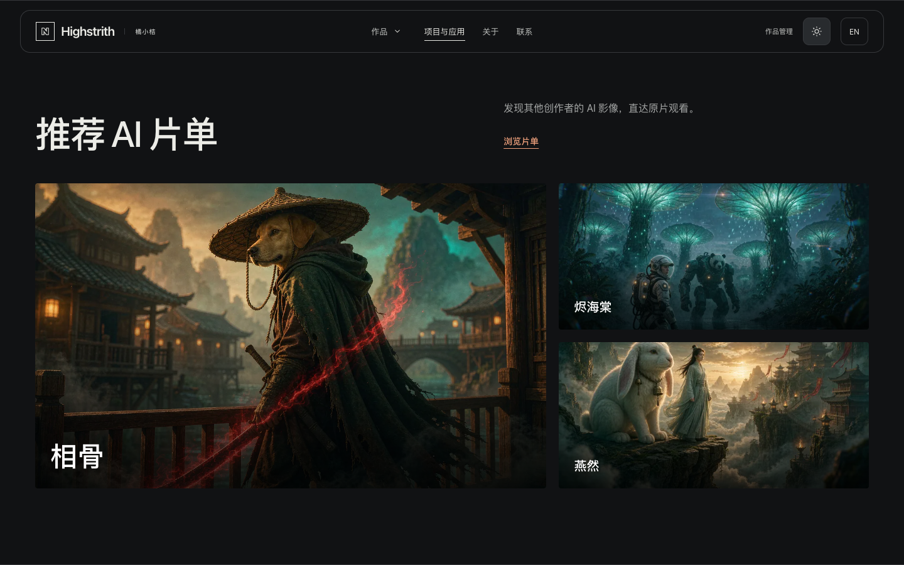
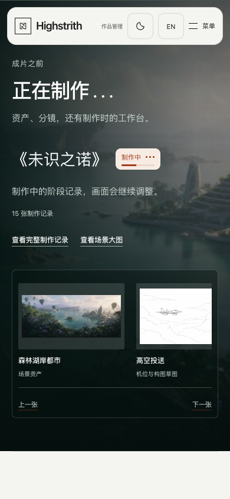
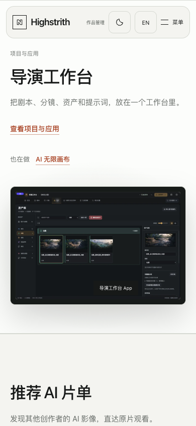
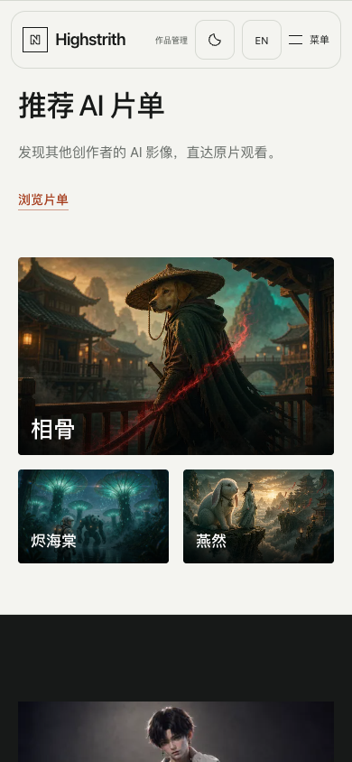

# 三个章节的视觉层次

2026-11-01。用户反馈「正在制作」单调，补充导演台和片单也要调整，并选择「更有沉浸感：大画面、前后层次、轻微动效」。本轮仅本地预览、验证和提交。

## 2026-11-01 首页环境背景系统追加

用户随后确认最满意带真实场景的「正在制作」，并明确不为每个页面单独生成底图。追加版本把上一轮三个重点章节扩展为首页共享环境系统：首屏与全部作品用暖纸色／灰绿柔光，作品截图转为深色画廊，导演台用冷灰绿环境光，推荐片单用暖色放映室色温，关于与联系只做克制衔接；制作区仍是最深的真实场景。实现只增加CSS多层渐变、明暗和阴影，不新增图片请求、字体、第三方依赖或JS调度，并提供深浅主题变体。

新增行为验收先红后绿，随后章节6、整屏3、排版2、制作图带9、精选动效5、联系4、弹性标题4、Pages打包2共35项通过。真实Chrome核对1440×900桌面、390×844手机与深色主题，桌面／手机横向宽度均为视口宽。三套浏览器测试并发时曾有3个图带用例因等待networkidle超时，单独重跑9项全部通过。追加截图保存在`ambient-chapters-20261101/`，本轮仅本地提交，未推送或发布。

用户随后指出「正在制作」「作品截图」等深色章节切换深浅模式几乎一样。修正为真正的主题双版本：浅色模式的制作场景罩层、截图画廊和关于区是偏灰绿、带暖光的炭色；深色模式进一步压到近黑、加强边缘暗角和冷色阴影。新增真实浏览器用例先复现制作区两主题背景完全相同，再验证三个区域均发生变化；最终相关36项通过，桌面与手机深浅对照保存在`ambient-chapters-20261101/`的`*-light.png`、`*-dark.png`。

## 参考与复用评估

开始制作前查找了开源展示方案：[Cimaise](https://github.com/fabiodalez-dev/Cimaise)的摄影作品展示和图带组织，以及[Enhance设计作品集](https://enhance.dev/blog/posts/2023-06-20-enhance-design-portfolio)的大图配缩略图／原生回退思路。当前静态站已有15张制作图、轮播、GSAP与原生大图弹窗，接入图库CMS或另一个轮播会重复已有功能。因此仅参考版式思路，没有复制第三方代码或素材，没有增加库或许可义务。

## 实现

- 制作：真实森林湖岸城市场景作为通栏章节背景，三层渐暗区分天空、文字和图带。项目标题／状态／说明在上，原图带通栏置底；15张原图、220／180px小图、暂停和前后浏览保留。查看场景大图进入原15张序列的第一张，支持Esc、浏览器前进／后退和焦点返回；无脚本直接开原图。
- 导演台：保留约1:2图文比例，用大幅应用界面、轻微透视、阴影和前景分镜建立层次。前景仅装饰，不抢主链接或暂停按钮。小于1000px收回透视／前景，减少动态同样取消变形。
- 片单：一张主封面与右侧两张上下排列的副封面，片名置于渐暗画面中。悬停轻微放大，所有链接继续当前标签进入reel/。手机一张主封面加下方两张，采用自然章节高度。
- 使用现有真实媒体；背景响应式960／1920px，片单640／1280px并更新sizes。异步目录确定下方章节距离后再赋背景src/srcset，保持native lazy和无脚本回退。手机初始图片实测104,621B。

## 验证

27项相关真实行为与构建契约通过：chapter-scenes 5、home-modules 3、production-strip 9、projects片单3、director-word 4、冷启动图片预算1、Pages2。另运行studio.js语法和Git空白检查。

新增检查覆盖背景全幅、大图15张序列／历史／焦点、主副封面比例、320／390／820／1440短窗／1920双语、双主题鼠标切换、无脚本。原检查继续覆盖整屏比例、图带完整循环／暂停／接缝／键盘／触摸／库失败，以及弹性文字。

开发时发现网格默认最小尺寸会被max-content图带撑大；显式限制列和内层min-width，同时加入文字实际屏内位置检查。一次旧片单锚点断言遇到目录异步定位的短暂2.25px误差，独立重跑和最终三项完整回归通过；没有修改原断言。主题验证中自动定位器点击粘性头部会滚动页面，实际鼠标点击／直接事件与属性切换保持位置，新增正常动态真实鼠标回归确认。

IAB检查正常动效下的三块桌面，以下截图使用独立Chrome拍摄，桌面1440×900、手机390×844，减少动态方便核对最终稳定版式。

IAB正常动态导演台（1280×720，带透视和前景）：

