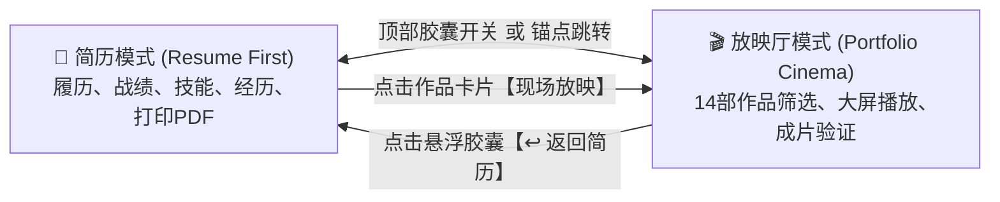

# 交互式网页简历与作品展厅双模式设计规格 (Dual-Mode Interactive Resume & Cinema Spec)

- **作者**：Antigravity & 林俊杰 (Highstrith)
- **日期**：2026-10-23
- **页面文件**：`/Volumes/E61--/网站/site-portfolio-upgrade/resume.html`
- **样式与脚本**：`assets/resume.css`、`assets/resume.js`、`assets/site-qr.svg`
- **线上访问地址**：`https://highstrith.github.io/highstrithstate/resume.html`

---

## 1. 核心定位与体验架构 (Core Vision)

将 `resume.html` 打造为一个**以「个人简历为主导」，同时无缝融合「作品集放映厅」的双模式互联单页（Dual-Mode App）**。

### 核心流转机制：

1. **默认简历主导 (Resume First)**：访客（HR、面试官、客户）打开页面，直接映入眼帘的是极具现代设计杂志质感的完整个人履历，迅速建立信任与专业认知。
2. **沉浸式动态跳转与切回**：
   - 顶部常驻分段胶囊选择器：`[ 📄 履历档案 ｜ 🎬 作品放映厅 ]`；
   - 点击简历中的任意代表作（如《AI患者》、产品三维实验等）上的【🎬 立即放映】，页面通过平滑的过渡动画切入放映厅并直接拉起高清视频播放器；
   - 放映厅右上方常驻高亮胶囊【↩️ 返回个人简历】，点击无缝带回简历视图，保留精准滚动上下文。
3. **打印与纸质导出 (`@media print`)**：
   - 触发 `window.print()` 时，放映厅与多余交互按钮自动隐藏；
   - 简历视图自适应为标准的 1~2 页精美黑白求职 A4 排版；
   - 醒目嵌入 `site-qr.svg` 矢量二维码与 `highstrith.github.io/highstrithstate/` 网址，支持手机扫码秒看作品。

---

## 2. 页面详细模块设计

### 2.1 顶部全局切换导航 (`.dual-nav`)
- **左侧**：品牌标识 `Highstrith · 橘小桔`（点击平滑回主站或置顶）。
- **中央**：**分段切换胶囊（Segmented Control）**
  - `[ 📄 个人简历 ｜ 🎬 作品放映厅 ]`
  - 点击带微弹动动画切换当前视界，同时同步 URL hash（`#resume` 或 `#cinema`）。
- **右侧**：
  - 【📱 手机看作品】：触发作品集二维码弹窗。
  - 【🖨️ 导出 PDF】：调出浏览器标准打印。
  - 【EN / 中文】：即时语言切换。

---

### 2.2 视图 A：个人简历视图 (`#view-resume`)

1. **Hero 概况与快速动作条**：
   - 姓名：林俊杰 ｜ 橘小桔 (Highstrith)
   - 核心定位印记：**「AIGC 视觉生成 × 3D 扎实底层」双引擎复合型创作者**
   - 标签快照：*26岁（2000年） · 4年视觉全流程实战 · 苏州大学应用技术学院 · 本科 · CET-4 · 南京全职 / 全国远程 · 随时到岗*
   - 联系矩阵：
     - 邮箱：`highstrith@gmail.com`
     - 电话：`+86 180 2016 9750`
     - 微信：`Gw1sgdsj_787`（点击复制，悬浮展示微信码）
     - 作品集：`highstrith.github.io/highstrithstate/`
   - 快速跳转条：
     - 【🎬 动态切换至作品放映厅】
     - 【📄 导出标准 A4 PDF 简历】
     - 【💬 复制联系方式】
2. **三大核心战绩与竞争力指标卡**：
   - **300+ 条商业交付**：服务微视文化等 30 余个中大型外包项目。
   - **60%+ 效率跃升**：AIGC 结合 3D 管线，将概念验证与预演周期大幅压缩。
   - **100% 单兵全闭环**：编剧、分镜、生成、Blender 资产到调色音效一体化交付。
3. **互动式技能矩阵**：
   - **AIGC 视觉栈**：Seedance 2.0、可灵 O3、Runway、Luma、MiniMax、Midjourney、ComfyUI、Nano Banana Pro 等。
   - **三维与空间栈**：Blender（建模/材质/渲染/绑定/动力学/动画）、UE5（场景搭建/电影运镜）、Cascadeur（AI 动力学辅助）。
   - **剪辑调色与后期**：DaVinci Resolve（色彩科学/ACES/调色）、After Effects（复杂包装/跟踪合成）、Premiere Pro、Photoshop。
4. **履历与商业实战时间轴**：
   - **微视文化传媒工作室（2025.03 – 至今）**：3D / AIGC 视觉设计师
   - **鹿创文化（2023.12 – 2024.11）**：剪辑师 / 视觉后期
   - **金铂利口腔集团（2022.07 – 2023.11）**：视频制作 / 编导剪辑
5. **精选代表作聚焦（一键放映通道）**：
   - 《AI患者》（原创 AI 概念微电影）：配有【🎬 现场放映】按钮，点击无缝切入放映厅并播放对应成片。
   - 商业三维渲染与动态视觉：配有【🎬 查看成片】直达放映。
6. **纸质版专属二维码区域**：
   - 在页面底部（并在打印时显示在首屏右上角）渲染 `site-qr.svg` 与说明文案：*“微信扫码或访问 highstrith.github.io/highstrithstate 直达在线高清视频作品集”*。

---

### 2.3 视图 B：作品集放映厅视图 (`#view-cinema`)

1. **顶部专属返回提示条**：
   - 左侧：当前位于「Highstrith 影像放映厅（共 14 部精选成片）」。
   - 右侧：常驻发光胶囊按钮**【↩️ 返回个人简历】**，点击立刻切回简历视图。
2. **分类与搜索过滤器**：
   - 分类筛选：全部 (14)、叙事短片 (Story)、三维与动画 (Motion)、剪辑与视觉 (Edit)。
   - 即时搜索框：快速按关键词过滤作品。
3. **精选作品放映网格**：
   - 继承主站作品数据（重置日、趴着办公早该知道、动作预演、产品视觉实验、特运尖兵片头、街巷角色动画、花与兔子、《AI患者》、街头篮球、Prove It、搭讪、Two Seconds、AI 之后等）。
   - 封面悬浮微动效，点击打开高质量沉浸式播放器弹窗。
4. **视频播放器弹窗 (`#cinemaPlayer`)**：
   - 原生 HTML5 视频播放，支持全屏、快进、ESC 退出播放。

---

## 3. 技术实现与文件组织

1. **HTML 组织 (`resume.html`)**：
   - 引用 `assets/base.css` 保证基础字体与系统级 Reset 统一；
   - 引用 `assets/resume.css` 承载双视图布局、动画过渡、时间轴与 `@media print`；
   - 引用 `assets/resume.js` 统一处理：视图状态机（`#resume` ⇄ `#cinema`）、视频播放器控制器、多语言 i18n 转换、剪贴板复制与二维码弹窗。
2. **视图切换逻辑 (State Management)**：
   - 通过 `active-view="resume"` 与 `active-view="cinema"` 属性在 `<body>` 上进行状态切换。
   - 切换时加入优雅的淡入与微滑动位移动效（`transition: opacity 0.3s ease, transform 0.3s ease`）。
   - 监听 `hashchange` 事件，支持浏览器前进/后退导航。
3. **矢量二维码 (`assets/site-qr.svg`)**：
   - 已由精确算法生成，完美对准 `https://highstrith.github.io/highstrithstate/`。

---

## 4. 验收清单 (Acceptance Criteria)

- [ ] 页面在浏览器打开默认渲染「简历模式」，排版高级，数据完整。
- [ ] 点击顶部胶囊「作品放映厅」，平滑切换到 14 部作品展厅。
- [ ] 点击作品集里的「返回个人简历」，平滑切回简历模式。
- [ ] 在简历模式下点击《AI患者》的「🎬 现场放映」，直接自动切换至放映厅并拉起播放器。
- [ ] 点击「一键复制」能成功将微信号复制到剪贴板并提示 Toast。
- [ ] 点击「手机看作品」能弹出高精度作品集二维码弹窗。
- [ ] 点击「打印 / 导出 PDF」，调起系统打印，打印预览版面干净整洁、无多余按钮、包含作品集二维码与网址。
- [ ] 点击中英语言切换，全页文本即时切换且不丢状态。
